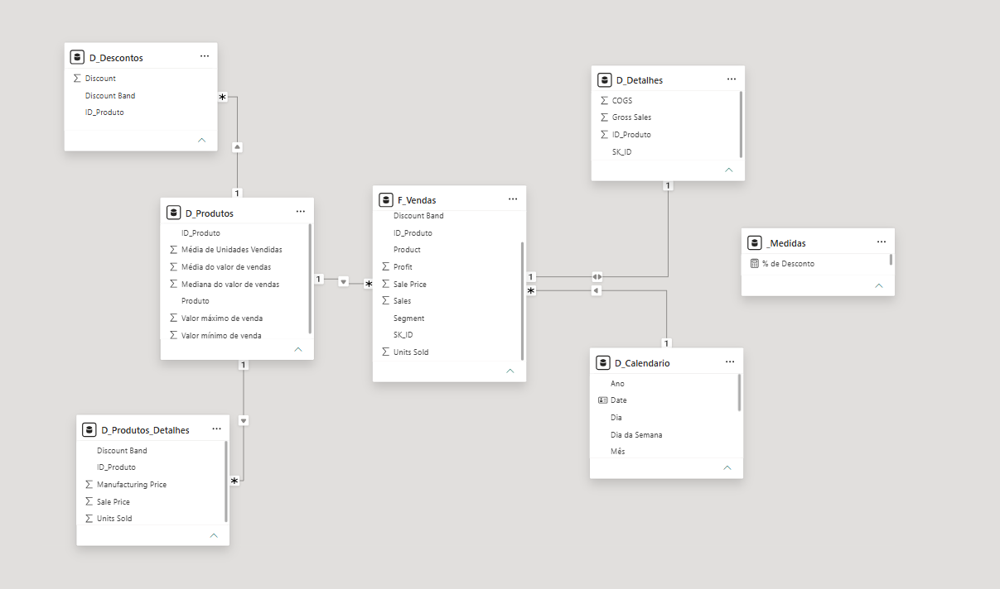
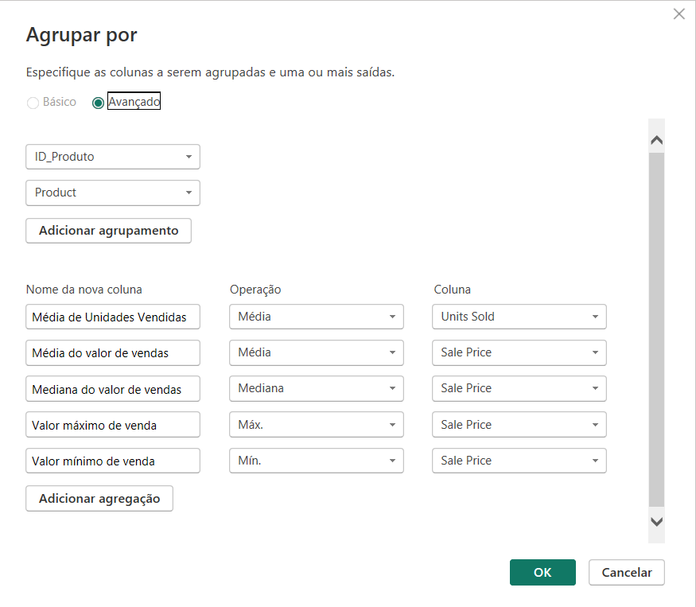
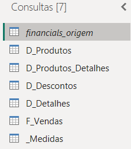
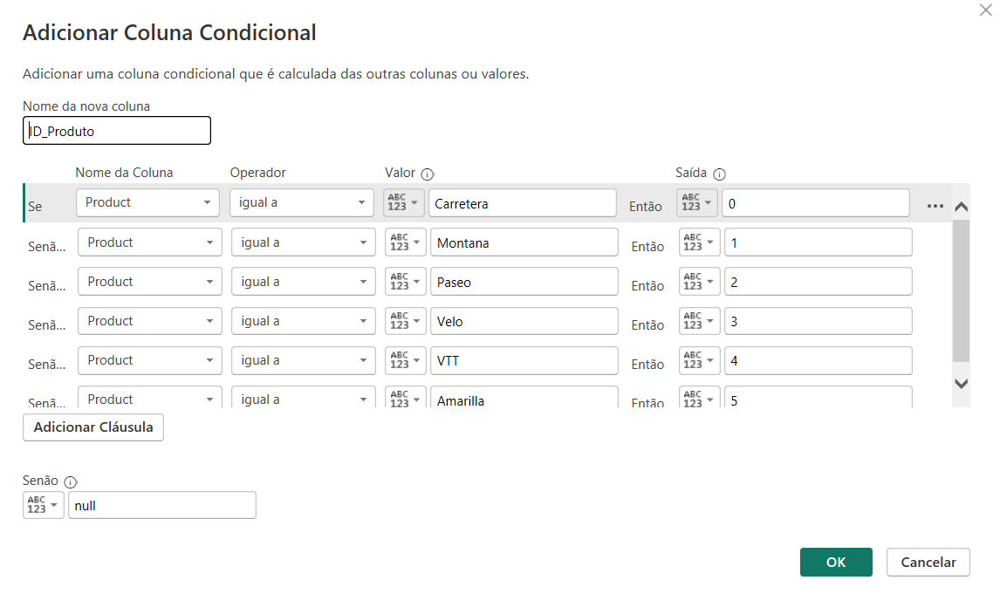
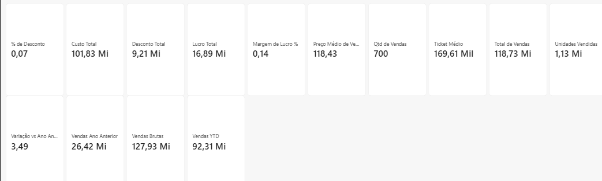

# Desafio DIO — Star Schema com Power BI: base Financial Sample

Transformação de uma tabela única e desnormalizada em um **modelo dimensional** no Power BI, com dimensões construídas no Power Query, tabela de datas em DAX e um conjunto de medidas analíticas.

Desafio da formação **Power BI Analyst** da [DIO](https://www.dio.me/), módulo de modelagem de dados.



---

## O desafio

> Utilizaremos a tabela única de Financial Sample para criar as tabelas dimensão e fato do nosso modelo baseado em star schema. O processo consiste na criação das tabelas com base na tabela original. A partir da cópia serão selecionadas as colunas que irão compor a visão da nova tabela.

O enunciado especifica sete tabelas: `financials_origem` (oculta, backup), `D_Produtos`, `D_Produtos_Detalhes`, `D_Descontos`, `D_Detalhes`, `D_Calendário` (via DAX) e `F_Vendas`.

---

## A base

**Financial Sample**, amostra oficial da Microsoft distribuída no [repositório da formação](https://github.com/julianazanelatto/power_bi_analyst): 700 linhas, 16 colunas, período de setembro/2013 a dezembro/2014.

| Natureza | Colunas |
|---|---|
| Dimensões | Segment, Country, Product, Discount Band, Date, Month Number, Month Name, Year |
| Métricas | Units Sold, Manufacturing Price, Sale Price, Gross Sales, Discounts, Sales, COGS, Profit |

### Por que a fonte é o `.xlsx` e não um `.csv`

Durante a construção, uma versão em CSV foi testada e produziu médias infladas em `Units Sold`. A causa: 36 das 700 linhas têm casa decimal (`1618.5`), e o Power BI em português lê o ponto como **separador de milhar** — transformando 1618,5 em 16185. As demais colunas, sem decimais, passavam ilesas, o que torna o erro silencioso.

O `.xlsx` guarda o valor como número nativo, sem texto a interpretar, e elimina a questão de localidade. A alternativa, caso o CSV fosse obrigatório, seria `Alterar Tipo` → `Usando Localidade` → Inglês (Estados Unidos).

---

## Decisões de modelagem

### Duas chaves criadas na origem

Antes de derivar qualquer tabela, a consulta `financials_origem` recebe duas colunas:

**`SK_ID`** — índice sequencial a partir de zero, via `Adicionar Coluna` → `Coluna de Índice`. É a chave artificial de cada linha de venda.

**`ID_Produto`** — chave do produto, de 0 a 5, via `Adicionar Coluna` → `Coluna Condicional`.



Criá-las na origem, e não em cada tabela, é o que permite que todas as cópias herdem as duas chaves automaticamente. É o mesmo princípio de um ETL que gera a surrogate key uma vez e a propaga.

### A origem como backup oculto

`financials_origem` tem a opção `Habilitar carga` **desmarcada**. Ela alimenta todas as demais consultas por referência, mas não entra no modelo — não ocupa memória, não aparece no painel de campos, e permanece disponível caso alguma dimensão precise ser refeita.

### Dimensão de datas com anos completos

A `D_Calendario` não vai de `MIN` a `MAX` das vendas, e sim do **primeiro dia do ano inicial ao último dia do ano final** — 730 linhas, de 01/01/2013 a 31/12/2014, em vez das 457 que o intervalo real teria.

O motivo é prático: funções de inteligência temporal exigem anos completos. Com o calendário começando em setembro de 2013, `TOTALYTD` e `SAMEPERIODLASTYEAR` devolveriam valores errados para 2013 — sem erro, sem aviso, apenas números incorretos.

### `D_Detalhes` ligada à fato, não à dimensão de produto

O Power BI detectou automaticamente uma relação entre `D_Detalhes` e `D_Produtos` pela coluna `ID_Produto`, e desativou a relação com a `F_Vendas` para evitar o ciclo `F_Vendas → D_Produtos → D_Detalhes → F_Vendas`.

A ligação correta é com a fato: a `D_Detalhes` tem **uma linha por venda**, identificada por `SK_ID`, não uma linha por produto. A relação com `D_Produtos` foi excluída e a relação 1:1 com `F_Vendas` foi ativada.

### Este modelo é um snowflake, não uma estrela pura

Vale registrar com honestidade. Numa estrela, toda dimensão se liga diretamente à fato. Aqui, `D_Produtos_Detalhes` e `D_Descontos` se ligam à `D_Produtos`, que por sua vez se liga à `F_Vendas` — um nível de normalização a mais, que caracteriza o floco de neve.

Além disso, as duas contêm métricas (`Units Sold`, `Discounts`) e por isso têm granularidade quase idêntica à da fato: 698 e 653 linhas contra 700. Dimensões de verdade são pequenas e descritivas, como a `D_Produtos`, com 6 linhas.

A estrutura segue o que o enunciado define ao especificar essas tabelas com `ID_produto` como chave. O núcleo estrela do modelo é `F_Vendas` + `D_Produtos` + `D_Calendario`.

---

## As tabelas

| Tabela | Linhas | Papel |
|---|---:|---|
| `financials_origem` | 700 | Backup oculto, sem carga |
| `F_Vendas` | 700 | Fato — uma linha por venda |
| `D_Produtos` | 6 | Dimensão de produto, criada por agrupamento |
| `D_Produtos_Detalhes` | 698 | Detalhes de preço e volume |
| `D_Descontos` | 653 | Faixas e valores de desconto |
| `D_Detalhes` | 700 | Vendas brutas e custo, 1:1 com a fato |
| `D_Calendario` | 730 | Dimensão de datas, criada em DAX |

### Relacionamentos

| De | Para | Cardinalidade |
|---|---|---|
| D_Produtos[ID_Produto] | F_Vendas[ID_Produto] | 1 → * |
| D_Produtos[ID_Produto] | D_Produtos_Detalhes[ID_Produto] | 1 → * |
| D_Produtos[ID_Produto] | D_Descontos[ID_Produto] | 1 → * |
| F_Vendas[Date] | D_Calendario[Date] | * → 1 |
| F_Vendas[SK_ID] | D_Detalhes[SK_ID] | 1 → 1 |

---

## Processo de construção — Power Query

Cada dimensão nasce de uma **Referência** à `financials_origem` (botão direito → `Referência`), seguida da seleção de colunas e, quando necessário, da remoção de duplicatas.

Referência em vez de Duplicata é uma escolha deliberada: a duplicata copia todas as etapas e cria uma consulta independente, enquanto a referência aponta para o resultado da original. Qualquer correção na origem se propaga sozinha para as seis consultas.



### Funcionalidades utilizadas

| Recurso | Onde |
|---|---|
| Referência de consulta | criação das cinco tabelas derivadas |
| Coluna de Índice | `SK_ID` na origem |
| Coluna Condicional | `ID_Produto` na origem |
| Agrupar por (avançado) | `D_Produtos`, com cinco agregações |
| Escolher Colunas | todas as tabelas derivadas |
| Remover Duplicatas | `D_Produtos_Detalhes`, `D_Descontos` |
| Renomear colunas | `" Sales"` → `"Sales"`, `"Discounts"` → `"Discount"` |
| Desabilitar carga | `financials_origem` |
| Editor Avançado (M) | todas as consultas |

### D_Produtos — criada por agrupamento

O `Agrupar por` em modo avançado, agrupando por `ID_Produto` e `Product`, com cinco agregações sobre as colunas de preço e volume.



```m
let
    Origem = financials_origem,
    Agrupado = Table.Group(
        Origem,
        {"ID_Produto", "Product"},
        {
            {"Média de Unidades Vendidas", each List.Average([Units Sold]), type number},
            {"Média do valor de vendas",   each List.Average([Sale Price]), type number},
            {"Mediana do valor de vendas", each List.Median([Sale Price]),  type number},
            {"Valor máximo de venda",      each List.Max([Sale Price]),     type number},
            {"Valor mínimo de venda",      each List.Min([Sale Price]),     type number}
        }
    ),
    Renomeado = Table.RenameColumns(Agrupado, {{"Product", "Produto"}}),
    Ordenado  = Table.Sort(Renomeado, {{"ID_Produto", Order.Ascending}})
in
    Ordenado
```

Resultado:

| ID | Produto | Méd. unidades | Méd. venda | Mediana | Máx | Mín |
|---:|---|---:|---:|---:|---:|---:|
| 0 | Carretera | 1578,99 | 111,77 | 20 | 350 | 7 |
| 1 | Montana | 1658,04 | 117,10 | 20 | 350 | 7 |
| 2 | Paseo | 1674,45 | 108,18 | 20 | 350 | 7 |
| 3 | Velo | 1490,13 | 115,24 | 20 | 350 | 7 |
| 4 | VTT | 1548,47 | 138,59 | 20 | 350 | 7 |
| 5 | Amarilla | 1652,29 | 128,68 | 20 | 350 | 7 |

### D_Detalhes — o que sobrou

O enunciado pede, com asterisco, "as informações que não foram contempladas nas demais tabelas dimensão". Conferindo coluna por coluna o que já havia sido alocado, restam exatamente duas: **`Gross Sales`** e **`COGS`**.

```m
let
    Origem = financials_origem,
    Selecionado = Table.SelectColumns(Origem, {"SK_ID", "ID_Produto", "Gross Sales", "COGS"}),
    Ordenado = Table.Sort(Selecionado, {{"SK_ID", Order.Ascending}})
in
    Ordenado
```

O código M completo das seis consultas está em [`powerquery/`](powerquery/).

---

## Processo de construção — DAX

### D_Calendario

```dax
D_Calendario = 
VAR DataInicial = DATE( YEAR( MIN( F_Vendas[Date] ) ), 1, 1 )
VAR DataFinal   = DATE( YEAR( MAX( F_Vendas[Date] ) ), 12, 31 )
RETURN
ADDCOLUMNS(
    CALENDAR( DataInicial, DataFinal ),
    "Ano",                     YEAR( [Date] ),
    "Trimestre",               "T" & QUARTER( [Date] ),
    "Número do Mês",           MONTH( [Date] ),
    "Mês",                     FORMAT( [Date], "mmmm" ),
    "Mês Abreviado",           FORMAT( [Date], "mmm" ),
    "Mês/Ano",                 FORMAT( [Date], "mmm/yyyy" ),
    "Dia",                     DAY( [Date] ),
    "Dia da Semana",           FORMAT( [Date], "dddd" ),
    "Número do Dia da Semana", WEEKDAY( [Date] ),
    "Semana do Ano",           WEEKNUM( [Date] )
)
```

Funções: `CALENDAR` gera a sequência de datas; `ADDCOLUMNS` acrescenta os atributos derivados; `VAR` evita recalcular os limites; `FORMAT`, `YEAR`, `QUARTER`, `MONTH`, `DAY`, `WEEKDAY` e `WEEKNUM` extraem as partes da data.

Após criada, a tabela foi marcada em `Ferramentas de Tabela` → **`Marcar como tabela de data`**, pela coluna `Date`. Sem isso o Power BI não reconhece a hierarquia temporal e as funções de inteligência temporal falham silenciosamente.

### Medidas

Todas organizadas numa tabela vazia chamada `_Medidas`, criada com `Inserir dados`. O underline a mantém no topo do painel de campos e evita que as medidas fiquem espalhadas entre as colunas das tabelas de dados.



**Base**

```dax
Total de Vendas   = SUM( F_Vendas[Sales] )
Vendas Brutas     = SUM( D_Detalhes[Gross Sales] )
Custo Total       = SUM( D_Detalhes[COGS] )
Lucro Total       = SUM( F_Vendas[Profit] )
Unidades Vendidas = SUM( F_Vendas[Units Sold] )
Qtd de Vendas     = COUNTROWS( F_Vendas )
```

`Vendas Brutas` e `Custo Total` leem da `D_Detalhes` e ainda assim respondem a filtros aplicados na `F_Vendas`, porque a relação 1:1 entre as duas propaga filtro nos dois sentidos.

**Derivadas**

```dax
Desconto Total       = [Vendas Brutas] - [Total de Vendas]
Margem de Lucro %    = DIVIDE( [Lucro Total], [Total de Vendas] )
% de Desconto        = DIVIDE( [Desconto Total], [Vendas Brutas] )
Ticket Médio         = DIVIDE( [Total de Vendas], [Qtd de Vendas] )
Preço Médio de Venda = AVERAGE( F_Vendas[Sale Price] )
```

`DIVIDE` no lugar do operador `/` devolve vazio quando o denominador é zero, em vez de erro — relevante num relatório com segmentadores, onde recortes sem vendas são questão de tempo.

`Desconto Total` explora uma identidade da base: vendas brutas menos vendas líquidas equivale à soma dos descontos, conferida até os centavos.

**Inteligência temporal**

```dax
Vendas YTD = TOTALYTD( [Total de Vendas], D_Calendario[Date] )

Vendas Ano Anterior = 
CALCULATE( [Total de Vendas], SAMEPERIODLASTYEAR( D_Calendario[Date] ) )

Variação vs Ano Anterior % = 
DIVIDE( [Total de Vendas] - [Vendas Ano Anterior], [Vendas Ano Anterior] )
```

Estas três dependem diretamente da decisão de construir o calendário com anos completos. `CALCULATE` altera o contexto de filtro; `SAMEPERIODLASTYEAR` desloca o período um ano para trás; `TOTALYTD` acumula do início do ano até a data corrente.

---

## Validação

Totais sem nenhum filtro aplicado, conferidos contra o arquivo de origem:

| Medida | Valor |
|---|---:|
| Total de Vendas | 118.726.350,26 |
| Vendas Brutas | 127.931.598,50 |
| Desconto Total | 9.205.248,24 |
| Custo Total | 101.832.648,00 |
| Lucro Total | 16.893.702,26 |
| Unidades Vendidas | 1.125.806 |
| Qtd de Vendas | 700 |
| Margem de Lucro % | 14,23% |
| % de Desconto | 7,20% |
| Ticket Médio | 169.609,07 |
| Preço Médio de Venda | 118,43 |

Duas identidades contábeis fecham exatamente, o que valida a separação das colunas entre as tabelas:

```
Vendas Brutas − Desconto Total = Total de Vendas
Total de Vendas − Custo Total  = Lucro Total
```

A inteligência temporal também confere: `Total de Vendas` dá 26.415.255,51 em 2013 e 92.311.094,75 em 2014, e `Vendas Ano Anterior` em 2014 reproduz o valor de 2013.

---

## Estrutura do repositório

```
.
├── README.md
├── star-schema-financials.pbix
├── powerquery/
│   └── consultas.m                 código M das seis consultas
├── dax/
│   ├── d_calendario.dax            tabela de datas
│   └── medidas.dax                 as 14 medidas
└── img/
    ├── modelo-estrela.png          visão de modelo
    ├── power-query-consultas.png   as consultas criadas
    ├── agrupar-por.png             agrupamento da D_Produtos
    ├── coluna-condicional.png      criação do ID_Produto
    └── medidas-cartoes.png         medidas validadas
```

---

## Como reproduzir

1. Baixe o `Financial Sample.xlsx` do [repositório da formação](https://github.com/julianazanelatto/power_bi_analyst) (Módulo 1 → Primeiros passos com Power BI)
2. Abra o `star-schema-financials.pbix` no Power BI Desktop
3. Em `Transformar dados` → `Configurações da fonte de dados`, aponte para o caminho local do arquivo
4. `Fechar e Aplicar`

---

## Tecnologias

Power BI Desktop · Power Query (linguagem M) · DAX

---

**Antônio Pagnano** · [GitHub](https://github.com/antoniolpagnano) · [LinkedIn](http://linkedin.com/in/antoniolpagnano)
